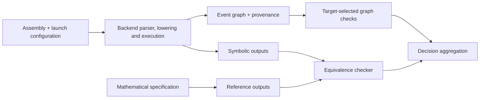

# Architecture and development guide

The engine has three independent responsibilities: construct a candidate
execution, check its safety graph, and compare its mathematical outputs.
`volta_pipeline` composes them for the CLI and Python interfaces.



The graph checker never calls the interpreter or equivalence checker. The
equivalence checker consumes expressions, not events. This separation keeps an
arithmetic identity from hiding a synchronization defect, and a safe execution
from standing in for correct output values. Accepting a kernel comparison needs
both assembly executions and both graph checks. An early certified rejection of
the reference can end comparison before the second execution. Dependency boundaries are enforced
by [architecture_tests.rs](../crates/volta_pipeline/tests/architecture_tests.rs).

## Follow one kernel

1. `volta_cli/src/main.rs` or the PyO3 bindings select a backend and build an
   `AnalysisConfig`. `volta_common::config` validates shared geometry, arrays,
   arguments and allocation premises. The JSON launch reader lives in
   `volta_ptx_analysis/src/launch_file.rs` and serves both backends.
2. The CLI/Python interface parses the source into a `KernelModule`, then
   `volta_pipeline/src/backend.rs` dispatches analysis. PTX and native AMD have
   separate frontends, lowering and interpreters. Their outputs share
   `volta_expr` and `volta_graph` contracts.
3. The interpreter computes an expression DAG and records memory, register,
   synchronization and lifetime events for one execution. Provenance carries
   target, geometry, source spans and modeling assumptions. The terminal state
   distinguishes completion, a stuck execution and an abort.
4. `volta_graph_check::check_graph` selects the applicable checks from target
   provenance. Native AMD uses completeness, readiness, barrier-generation and
   memory-conflict checks. PTX has separate barrier, memory, proxy, tensor and
   resource checks. Each returns evidence, typed witnesses or unresolved reasons.
5. `volta_spec` turns a mathematical specification into the same output
   expression representation. `volta_equivalence` compares exact per-array index
   sets and expressions, with optional numerical oracle confirmation.
6. `volta_pipeline::decide` combines the independent results. `ACCEPT` needs
   complete equivalence and a completed trace with every applicable graph check
   passing. In ordinary execution, a refutation, index mismatch, failed check or
   deadlock yields `REJECT`; a missing proof yields `UNKNOWN`. A generic observer
   stop remains `UNKNOWN` even when its prefix contains failed-property diagnostics;
   a rejected prefix requires a separately validated property certificate.

For native AMD, `frontend::Instruction` represents assembly syntax.
`lower_kernel_in_module` validates the target and constructs distinct
`ir::Instruction` values with typed operations, resolved branches, decoded waits
and memory/matrix operand roles. Syntax-only labels and wait lists cannot enter
ordinary executable operands. Each instruction retains its source mnemonic,
encoding, modifiers and span at the original PC for diagnostics and graph
provenance. Parsed syntax and caller-built ASTs share normalization and operand
validation. Lowering normalizes a clone, including implicit VCC operands and FP64
constants, then checks target and descriptor constraints; it leaves the caller's
AST unchanged. Executable instruction accessors are read-only. This IR is
implemented in Rust; it does not depend on LLVM or MLIR.

## Shared contracts

| Crate | Data and responsibility |
| --- | --- |
| `volta_common` | Source spans, diagnostics, launch primitives and run logs |
| `volta_expr` | Interned expression DAG, symbolic output indices and text exchange |
| `volta_spec` | Specification parser, dimension binding and formula unfolding |
| `volta_graph` | Typed events, edges, memory/register footprints and provenance |
| `volta_graph_check` | Independent graph properties and their certificates/witnesses |
| `volta_equivalence` | Algebraic equivalence, numerical refutations and VC serialization |

The `volta_amd_analysis` crate contains an experimental typed gfx950 interpreter
with copy/add output fixtures. Its graph has no access events and supplies no
native safety proof. The native `amdgpu` CLI backend uses
`volta_amdgpu_analysis`; these crate names do not select interchangeable
implementations. `volta_trainium_analysis` contains an NKI example and module
boundaries, with no execution or CLI backend yet.

The optional gfx1250 [early readiness observer](early-readiness.md) consumes
complete instruction batches using checker-owned scalar readiness transitions.
The pipeline replays a proposed witness and revalidates the halted prefix before
exposing a certified rejection. A generic observer stop remains inconclusive.
No early acceptance path is added. Disabling the observer retains the ordinary
diagnostic path; unsupported execution or other errors can still abort a trace.

The separate [early memory-conflict observer](early-memory-conflicts.md) handles
gfx950/gfx1250 ordinary writes by different active lanes of one issued GLOBAL
or direct DS/LDS instruction. Interval discovery proposes an untrusted witness;
the existing target-selected checker must reproduce its exact pair and byte,
with valid trace, readiness and barrier premises. The pipeline validates both
the live and halted prefix. Candidate refusal permits later issues to be
considered; only a privately constructed certificate authorizes rejection.
Default full execution and mathematical-output requirements remain unchanged.

Supported gfx1250 [tensor LDS bounds faults](tensor-bounds.md) have a separate
prefix certificate, including in default mode. The producer records an attempted
access and aborts before
memory issue. The checker validates its descriptor, configured LDS extent,
source readiness and barrier reachability. The pipeline exposes only the
certified rejection; the incomplete graph and absent outputs cannot establish
acceptance or equivalence.

Shared configuration includes PTX aggregate fields and native ABI byte payloads,
but each backend accepts only its own forms. The
[parameter guide](launch-parameters.md) distinguishes JSON, Rust and Python
interfaces and explains host tensor-map layouts.

Native target differences belong in target profiles and explicit opcode/event
contracts. gfx942/gfx950 use wave64 MFMA rules; gfx1250 uses wave32 WMMA and
different counters and barrier objects. See the
[CDNA graph contract](gfx942-graph-contract.md) and
[gfx1250 model](../tests/gfx1250/CONTRACT.md). Never infer support by changing a
target string or accepting an opcode name without its operand profile.

## Extending an instruction

Follow the existing modules for the relevant backend:

1. Define its legal source grammar and typed operands. Validate every instruction
   in the selected entry, including unreachable and empty-EXEC code.
2. Lower it into the backend's typed instruction representation. Keep target,
   widths, modifiers and address spaces explicit.
3. Implement value semantics in the interpreter. Preserve byte definedness,
   source/destination widths and the existing arithmetic model.
4. Record its complete graph effects: register reads/writes, memory footprints,
   issue/completion attribution and any source lifetime.
5. Extend the independent graph checks when the new event changes readiness,
   publication, synchronization progress or resource lifetime.
6. Add an actual source fixture and a supported positive control, then malformed
   syntax and meaningful semantic negatives. Assert a typed witness for harmful
   executions; an aborted or unknown run is a separate result.

Use pinned public references and genuine compiler/assembler output for native
forms. Keep source, assembly, compiler commands and hashes together. Generate
run artifacts outside the source tree. The static profile inventories describe
what parses and lowers; they are not substitutes for execution or numerical tests.

## Tests and maintenance

PTX end-to-end fixtures live under `crates/volta_pipeline/tests/ptx`, with
integration suites in the parent directory. Native fixtures and launch/spec
contracts live under `tests/gfx942`, `tests/gfx950` and `tests/gfx1250`, with
additional frontend fixtures beside `volta_amdgpu_analysis`. Backend unit tests
exercise grammar, lowering and interpreter internals. Pipeline tests compose
execution with typed graph findings and mathematical output checks.

Keep Rust tests near the layer whose contract they exercise. Equivalence-only
tests use expressions/specifications; graph-only tests construct typed graphs;
end-to-end tests verify actual assembly. Include full array/index coverage and
supported controls when testing errors. Do not turn unsupported or incomplete
execution into an expected successful result.

Use `cargo test --release --workspace`, `just test-python`,
`cargo fmt --all -- --check` and `cargo clippy --workspace --all-targets -- -D warnings` for
general changes. Fixture-specific tools have their own README commands. Large
workload proofs and hardware numerical checks run separately with explicit
budgets. The [usage guide](usage.md) explains how to inspect logs and exported
graphs when diagnosing a failure.

Source changes can invalidate current test hashes and generated code references
even when fixture behavior is unchanged. After reviewing those changes and
updating their current source pins, regenerate the derived inventories:

```sh
python3 tests/gfx1250/full-parity/generate_stage_profiles.py
python3 tests/gfx950/generate_instruction_coverage.py
python3 tests/gfx1250/full-parity/validate_feature_mappings.py \
  --output tests/gfx1250/full-parity/feature-mappings-index.json
```

Both stage generators invoke Cargo's `instruction_inventory` example and respect
`CARGO_TARGET_DIR`. Use a separate target directory for each checkout. Their
`--check` modes reject generated drift without writing files. The
[source-contract guide](../tests/gfx1250/full-parity/README.md#validate-source-registrations)
lists the reference, native output-contract and refusal checks. Preserve pinned
historical references and original workload shapes, dtypes and output projections;
refreshing current code references does not redefine those contracts or prove
runtime coverage.

Update the owning crate README when its behavior or public interface changes.
Document lasting contracts, assumptions and failure modes rather than completed
tasks or transient run summaries. Keep detailed function/type documentation in
Rustdoc and link to it or the source instead of maintaining duplicate listings.
